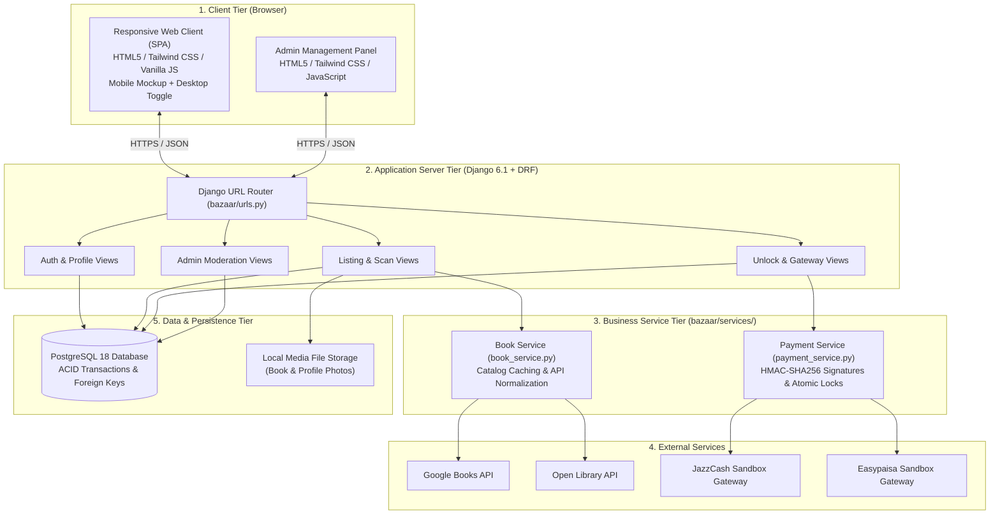
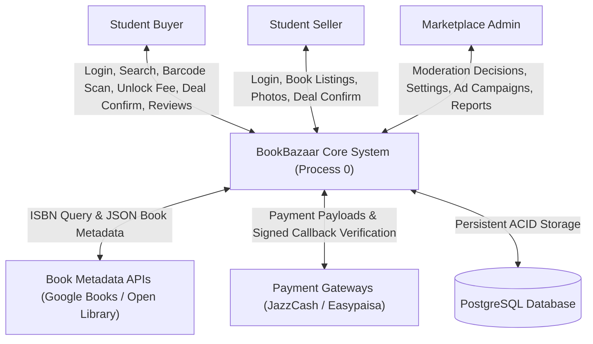
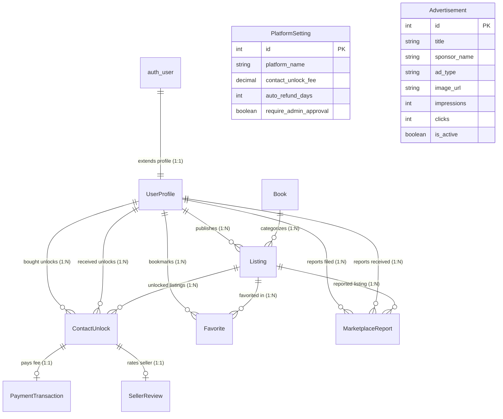

# Software Design Document (SDD)
## for
# BookBazaar
### Used Book Marketplace & Academic Textbook Barcode Platform for Pakistan
**Version 2.0 (Production Implementation Edition)**

---

### Department of Software Engineering
**Faculty of Computing**  
**The Islamia University of Bahawalpur**

**Project Team:**
- **Emaan Mazari** — Roll No: `F23BSEEN1E02157`
- **Laila Akhtar** — Roll No: `F23BSEEN1E02119`

**Project Advisor:**
- **Sir Gulraiz** — Department of Software Engineering, The Islamia University of Bahawalpur

---

## Revision History

| Version | Date | Authors | Reason for Changes |
| :--- | :--- | :--- | :--- |
| **1.0** | 3 Nov 2026 | Emaan Mazari, Laila Akhtar | Initial Design Draft |
| **2.0** | 9 Nov 2026 | Emaan Mazari, Laila Akhtar | Full redesign aligning architecture, component algorithms, ERD, and API routes with the implemented Django REST backend, PostgreSQL 18 schema, HTML5/Tailwind responsive client, DRF Token authentication, internal wallet refunds, and admin panel |

---

## Document Approval

The following Software Design Document (Version 2.0) has been accepted and approved by:

| Signature | Printed Name | Title | Date |
| :--- | :--- | :--- | :--- |
| | **Sir Gulraiz** | Project Supervisor, Department of Software Engineering | ___________ |

---

## Table of Contents

1. [Introduction](#1-introduction)
   - [1.1 Purpose](#11-purpose)
   - [1.2 Scope](#12-scope)
   - [1.3 Overview](#13-overview)
   - [1.4 Reference Material](#14-reference-material)
   - [1.5 Definitions and Acronyms](#15-definitions-and-acronyms)
2. [System Overview](#2-system-overview)
3. [System Architecture](#3-system-architecture)
   - [3.1 Architectural Design](#31-architectural-design)
   - [3.2 Decomposition Description](#32-decomposition-description)
   - [3.3 Design Rationale & Technology Trade-offs](#33-design-rationale--technology-trade-offs)
4. [Data Design](#4-data-design)
   - [4.1 Data Description](#41-data-description)
   - [4.2 Entity-Relationship Diagram (ERD)](#42-entity-relationship-diagram-erd)
   - [4.3 Data Dictionary](#43-data-dictionary)
5. [Component Design](#5-component-design)
   - [5.1 Authentication & Profile Module](#51-authentication--profile-module)
   - [5.2 Scanner & Multi-Tier Catalog Module](#52-scanner--multi-tier-catalog-module)
   - [5.3 Seller & Listing Inventory Module](#53-seller--listing-inventory-module)
   - [5.4 Contact Unlock & Gateway Signature Verification Module](#54-contact-unlock--gateway-signature-verification-module)
   - [5.5 Deal Confirmation & In-App Wallet Refund Module](#55-deal-confirmation--in-app-wallet-refund-module)
   - [5.6 Proprietary Advertisement Module](#56-proprietary-advertisement-module)
   - [5.7 Admin Moderation & Dispute Mediation Module](#57-admin-moderation--dispute-mediation-module)
   - [5.8 Reputation & Seller Review Module](#58-reputation--seller-review-module)
6. [Human Interface Design](#6-human-interface-design)
   - [6.1 Overview of User Interface](#61-overview-of-user-interface)
   - [6.2 Screen Descriptions & UI Walkthrough](#62-screen-descriptions--ui-walkthrough)
   - [6.3 Screen Objects and Actions Mapping](#63-screen-objects-and-actions-mapping)
7. [Requirements Traceability Matrix](#7-requirements-traceability-matrix)
8. [Appendices](#8-appendices)
   - [Appendix A – Complete REST API Endpoints Reference](#appendix-a--complete-rest-api-endpoints-reference)
   - [Appendix B – System Settings & Default Values](#appendix-b--system-settings--default-values)
   - [Appendix C – Phase 6 Mobile App & Production Expansion Roadmap](#appendix-c--phase-6-mobile-app--production-expansion-roadmap)

---

# 1. Introduction

## 1.1 Purpose
This Software Design Document (SDD) describes the detailed system architecture, component decomposition, database structure, algorithmic procedures, and user interfaces of **BookBazaar**. It provides the formal engineering translation of the requirements set forth in the companion *BookBazaar Software Requirements Specification (SRS) v2.0*.

The target audience includes:
- **Project Supervisor & Evaluation Committee:** To verify that the software system demonstrates sound software architecture, robust database normalization, secure coding standards, and rigorous design practices.
- **Developers & Maintainers:** To serve as a technical blueprint for maintaining, debugging, and extending the codebase.
- **QA Engineers:** To trace component behavior and verify edge cases across payment verification, deal workflows, and catalog caching.

## 1.2 Scope
**Software Product:** **BookBazaar** is an enterprise-grade academic marketplace application featuring:
- A responsive, mobile-optimized Single Page Application (SPA) client developed with HTML5, Tailwind CSS, and Vanilla JavaScript, offering an interactive smartphone simulator frame and desktop widescreen toggle.
- A RESTful application server developed using Python, Django 6.1, and Django REST Framework (DRF).
- An ACID-compliant PostgreSQL 18 relational database.
- A comprehensive web-based Admin Management Panel (`/admin-panel/`) for real-time moderation, user administration, transaction auditing, and advertisement scheduling.

**Primary Objectives:**
1. Connect student buyers and sellers across Pakistani universities and educational boards.
2. Automate textbook inventory creation via camera-driven ISBN barcode scanning.
3. Protect user privacy and discourage bogus inquiries using a nominal, 100% refundable contact unlock fee (Rs. 50 PKR).
4. Provide local payment gateway integration for **JazzCash** and **Easypaisa** mobile wallets using HMAC-SHA256 cryptographic signatures.
5. Provide internal wallet refunds when peer-to-peer deals are cancelled or expire.

## 1.3 Overview
The document follows the IEEE 1016-2009 standard for Software Design Descriptions. Section 2 outlines the operational environment. Section 3 details the layered architecture, module decomposition, and design rationale. Section 4 provides the data design, PostgreSQL schema, and data dictionary. Section 5 presents component pseudo-code (PDL). Section 6 covers user interface layouts. Section 7 presents the traceability matrix, and Section 8 provides complete REST API documentation.

## 1.4 Reference Material
1. IEEE Std 1016-2009, *IEEE Standard for Information Technology — Systems Design — Software Design Descriptions*.
2. BookBazaar Software Requirement Specification (SRS), Version 2.0.
3. Django 6.1 Architecture & Design Patterns Documentation.
4. Django REST Framework API Guides (Authentication, Throttling, Serializers, ViewSets).
5. PostgreSQL 18 Documentation (Transactions, Row-level Locking, Indexes).
6. JazzCash & Easypaisa Merchant Integration & Security Whitepapers.

## 1.5 Definitions and Acronyms

| Term | Meaning |
| :--- | :--- |
| **SDD / SRS** | Software Design Document / Software Requirements Specification |
| **DRF** | Django REST Framework |
| **Token Auth** | HTTP Header Authentication (`Authorization: Token <key>`) managed by Django |
| **ISBN** | International Standard Book Number (ISO 2108), printed as an EAN-13 barcode |
| **PBKDF2** | Password-Based Key Derivation Function 2 (SHA-256), cryptographic password hashing |
| **HMAC-SHA256**| Keyed-Hash Message Authentication Code using SHA-256 |
| **SPA** | Single Page Application |
| **ACID** | Atomicity, Consistency, Isolation, Durability (database transaction properties) |
| **PKR / Rs.** | Pakistani Rupee |

---

# 2. System Overview

BookBazaar is engineered as a hyper-local, peer-to-peer textbook exchange ecosystem tailored to the economic and logistical realities of Pakistan. In higher education institutions like The Islamia University of Bahawalpur, textbooks are expensive (Rs. 1,500–3,500) and change hands each semester. 

Traditional e-commerce platforms (e.g. Daraz) rely on centralized warehousing, courier shipping (costing Rs. 250–400 per parcel), and seller commissions (15–20%). Because university students live on or near the same campus, physical delivery is unnecessary. BookBazaar replaces shipping logistics with **campus pickup locations** (e.g., *IUB Baghdad Campus Library*, *Gate 2*).

```text
+---------------------------------------------------------------------------------------+
|                                    BOOKBAZAAR ECOSYSTEM                               |
+---------------------------------------------------------------------------------------+
| 1. SCAN & AUTO-FILL  | Point camera at barcode -> Fetch Title, Author, Cover, Retail   |
| 2. SELLER LISTS      | Select Condition, Set Price (PKR), Enter Campus Pickup Point    |
| 3. BUYER COMPARES    | View all offers for the same book, sorted by lowest price       |
| 4. PRIVACY MASKING   | Seller phone masked (0301-*******) to eliminate spam & scrapers |
| 5. UNLOCK CONTACT    | Buyer pays Rs. 50 via JazzCash / Easypaisa / In-App Wallet      |
| 6. HANDOVER & DEAL   | Students meet at campus -> If Deal Confirmed, platform keeps fee|
| 7. 100% REFUND       | If No Deal -> Rs. 50 instantly credited back to buyer wallet    |
+---------------------------------------------------------------------------------------+
```

---

# 3. System Architecture

## 3.1 Architectural Design

The system employs a **Layered Client-Server Architecture** divided into four logical tiers:
1. **Client Tier:** A responsive web application (SPA) running in user browsers, rendering both a mobile device mockup frame and full-screen desktop views, plus an administrative web dashboard.
2. **Presentation & API Routing Tier:** Django URL routers and DRF viewsets handling authentication, payload validation, and HTTP response formatting.
3. **Business Logic & Service Tier:** Specialized services isolating book catalog resolution (`book_service.py`) and financial gateway orchestration (`payment_service.py`).
4. **Data & Storage Tier:** A PostgreSQL relational database ensuring transactional atomicity (`select_for_update`), and local file storage for user profile pictures and book listing photographs.



### Subsystem Decomposition & Responsibilities:

| No. | Subsystem | Module File | Core Responsibilities |
| :--- | :--- | :--- | :--- |
| **1** | **Authentication & Profile** | `bazaar/views.py` | Registration with Pakistani phone validation, PBKDF2 password hashing, DRF Token generation, profile management, and demo user switching. |
| **2** | **Scanner & Catalog** | `bazaar/services/book_service.py` | Web camera video feed integration, ISBN-10/13 normalization, multi-tier lookup (Local DB -> Curated Catalog -> Google Books -> Open Library), and catalog caching. |
| **3** | **Listings & Search** | `bazaar/views.py` | Search indexing, multi-parameter filtering (Pakistani educational boards, class levels, cities, conditions), multi-seller price aggregation, and listing CRUD. |
| **4** | **Payment & Unlock** | `bazaar/services/payment_service.py` | Privacy masking (`0301-*******`), checkout initialization, HMAC-SHA256 signature verification, duplicate payment prevention, and atomic unlock creation. |
| **5** | **Deal & Wallet Refund** | `bazaar/views.py` | Deal status machine (`unlocked_pending` -> `deal_made` / `no_deal_refunded`), automated wallet balance crediting, and duplicate-refund protection. |
| **6** | **Proprietary Ad Engine**| `bazaar/models.py`, `views.py` | Delivery of first-party banners, interstitials, and native cards, impression counting, and click-through tracking. |
| **7** | **Safety & Moderation** | `bazaar/views.py` | Violation reporting, moderator review workflows, listing moderation, and user blocking/unblocking. |
| **8** | **Admin Dashboard** | `templates/bazaar/admin.html` | Real-time marketplace financial statistics, user controls, seller activity monitoring, transaction logs, and global platform settings. |

---

## 3.2 Decomposition Description

### Top-Level Data Flow Diagram (Level-0 DFD):



---

## 3.3 Design Rationale & Technology Trade-offs

1. **Responsive Web SPA (Tailwind + JS) vs. Native Flutter (Current Implementation vs Phase 6):**
   - *Rationale:* For university evaluation and cross-device grading, a Responsive Web Single Page App with an interactive smartphone mockup frame allows evaluators to test the mobile user experience instantly in any browser without installing APKs or managing Android SDK dependencies.
   - *Architectural Decoupling:* Because the client communicates exclusively via JSON over standard REST APIs, the backend is 100% ready for native mobile apps in Phase 6.
2. **Django 6.1 & Django REST Framework (DRF):**
   - *Rationale:* Django offers built-in ORM security against SQL injection, CSRF protection, secure password hashing (PBKDF2), and a production-grade administrative foundation. DRF provides standardized serialization, throttling, and token authentication.
3. **PostgreSQL 18 vs. SQLite:**
   - *Rationale:* SQLite lacks robust concurrent write performance and does not support row-level locking. PostgreSQL provides enterprise ACID guarantees, row-level locks (`select_for_update`), strong type enforcement, and transactional integrity required for financial payments.
4. **Internal Wallet Refund Model:**
   - *Rationale:* Live gateway reverse-payouts in Pakistan require complex banking merchant contracts and incur transaction deductions. Crediting refunds to the buyer's internal BookBazaar wallet (`wallet_balance += fee`) provides instant, zero-cost refunds that students can reuse immediately.
5. **DRF Token Authentication vs JWT:**
   - *Rationale:* Standard DRF database-backed tokens provide instantaneous server-side token invalidation upon logout or user blocking, eliminating the security risks of stale unrevoked JWTs.

---

# 4. Data Design

## 4.1 Data Description
The database is normalized to 3NF (Third Normal Form) and implemented in PostgreSQL 18. Primary keys are standard auto-incrementing integers (`id`) for high-performance indexing, complemented by globally unique UUIDs (`unlock_id`, `transaction_id`, `report_id`) for public API exposure.

## 4.2 Entity-Relationship Diagram (ERD)



---

## 4.3 Data Dictionary

### 4.3.1 `UserProfile` (`bazaar_userprofile`)
Extends Django's `auth_user` model with student marketplace profile information.

| Attribute | Data Type | Nullable | Description / Constraints |
| :--- | :--- | :---: | :--- |
| `id` | BigAutoField | No | Primary Key |
| `user_id` | Integer | Yes | One-to-One Foreign Key to `auth_user.id` (CASCADE) |
| `full_name` | VARCHAR(150) | No | User's full display name |
| `phone_number` | VARCHAR(20) | No | Unique, Pakistani phone format (`03XXXXXXXXX`) |
| `city` | VARCHAR(80) | No | City of residence (Bahawalpur, Lahore, Karachi, etc.) |
| `campus_or_area`| VARCHAR(150)| No | University campus / local residential area |
| `profile_picture`| VARCHAR(100)| Yes | File path to uploaded avatar image |
| `user_type` | VARCHAR(20) | No | `student`, `reader`, `bookstore`, `admin` |
| `rating` | DECIMAL(3,2) | No | Average seller rating (1.00 to 5.00, default 5.00) |
| `total_reviews`| Integer | No | Count of received reviews |
| `wallet_balance`| DECIMAL(10,2)| No | Current in-app digital balance in PKR (default 0.00) |
| `is_blocked` | Boolean | No | Administrative suspension flag (default False) |
| `created_at` | DateTime | No | Timestamp of account registration |

### 4.3.2 `Book` (`bazaar_book`)
Central catalog entity storing book metadata identified by ISBN.

| Attribute | Data Type | Nullable | Description / Constraints |
| :--- | :--- | :---: | :--- |
| `id` | BigAutoField | No | Primary Key |
| `isbn` | VARCHAR(20) | No | Unique normalized ISBN-10 or ISBN-13 string |
| `title` | VARCHAR(255) | No | Full book title |
| `author` | VARCHAR(255) | No | Author name(s) |
| `publisher` | VARCHAR(255) | Yes | Publishing house |
| `edition` | VARCHAR(50) | Yes | Edition (e.g. "7th Edition") |
| `category` | VARCHAR(100) | No | Academic discipline category |
| `education_board`| VARCHAR(100)| Yes | Educational board (Punjab, Federal, Cambridge, HEC) |
| `grade_class` | VARCHAR(100) | Yes | Class / Grade level (Matric, FSc, Bachelor, Master) |
| `subject` | VARCHAR(100) | Yes | Specific subject (e.g. Operating Systems) |
| `description` | Text | Yes | Synopsis or course summary |
| `cover_image` | Text | Yes | URL or base64 cover image string |
| `original_retail_price`| DECIMAL(10,2)| No | Estimated new retail price in PKR (default 1500.00) |
| `created_at` | DateTime | No | Timestamp of initial catalog creation |

### 4.3.3 `Listing` (`bazaar_listing`)
Specific offer published by a seller offering a book for sale.

| Attribute | Data Type | Nullable | Description / Constraints |
| :--- | :--- | :---: | :--- |
| `id` | BigAutoField | No | Primary Key |
| `book_id` | BigInteger | No | Foreign Key to `Book.id` (CASCADE) |
| `seller_id` | BigInteger | No | Foreign Key to `UserProfile.id` (CASCADE) |
| `condition` | VARCHAR(20) | No | `Brand New`, `Like New`, `Good`, `Fair` |
| `price` | DECIMAL(10,2)| No | Selling price in PKR decided by the seller |
| `city` | VARCHAR(80) | No | City of listing |
| `pickup_location`| VARCHAR(150)| Yes| Specific campus pickup point (e.g. Library Gate) |
| `description` | Text | Yes | Seller's condition notes |
| `photo_url` | Text | Yes | URL to book image |
| `image` | VARCHAR(100) | Yes | Uploaded file path in `media/listings/` |
| `status` | VARCHAR(20) | No | `active`, `pending`, `sold`, `inactive` |
| `is_sponsored` | Boolean | No | Boosted listing banner flag |
| `views_count` | Integer | No | Impression counter |
| `created_at` | DateTime | No | Creation timestamp |

### 4.3.4 `ContactUnlock` (`bazaar_contactunlock`)
Unified transactional model tracking contact unlocks, deal confirmation, and refund state.

| Attribute | Data Type | Nullable | Description / Constraints |
| :--- | :--- | :---: | :--- |
| `id` | BigAutoField | No | Primary Key |
| `unlock_id` | UUID | No | Unique public UUID token |
| `listing_id` | BigInteger | No | Foreign Key to `Listing.id` (CASCADE) |
| `buyer_id` | BigInteger | No | Foreign Key to `UserProfile.id` (CASCADE) |
| `seller_id` | BigInteger | No | Foreign Key to `UserProfile.id` (CASCADE) |
| `fee_amount` | DECIMAL(6,2) | No | Unlock fee paid in PKR (default 50.00) |
| `payment_method`| VARCHAR(30) | No | `jazzcash`, `easypaisa`, `card_safepay`, `wallet` |
| `transaction_id`| VARCHAR(100)| No | Unique gateway or internal transaction reference |
| `deal_status` | VARCHAR(30) | No | `unlocked_pending`, `deal_made`, `no_deal_refunded`, `disputed` |
| `buyer_confirmation`| VARCHAR(20)| No | `pending`, `confirmed`, `rejected` |
| `seller_confirmation`|VARCHAR(20)| No | `pending`, `confirmed`, `rejected` |
| `cancellation_reason`|Text | Yes | Reason entered if deal is cancelled |
| `refund_transaction_id`|VARCHAR(100)|Yes| Generated reference upon refund (`REF-XXXXXX`) |
| `refund_timestamp`| DateTime | Yes | Timestamp of wallet refund |
| `payment_timestamp`| DateTime | No | Timestamp of initial payment |

### 4.3.5 `PaymentTransaction` (`bazaar_paymenttransaction`)
Financial audit log recording gateway parameters, response codes, and timestamps.

| Attribute | Data Type | Nullable | Description / Constraints |
| :--- | :--- | :---: | :--- |
| `id` | BigAutoField | No | Primary Key |
| `transaction_id`| UUID | No | Unique transaction UUID |
| `gateway_ref` | VARCHAR(120) | Yes | Reference assigned by gateway |
| `buyer_id` | BigInteger | No | Foreign Key to `UserProfile.id` (CASCADE) |
| `listing_id` | BigInteger | No | Foreign Key to `Listing.id` (CASCADE) |
| `amount` | DECIMAL(10,2)| No | Amount paid in PKR |
| `gateway` | VARCHAR(30) | No | `jazzcash`, `easypaisa`, `card_safepay`, `wallet` |
| `status` | VARCHAR(20) | No | `pending`, `completed`, `failed`, `refunded` |
| `gateway_response_code`|VARCHAR(50)|Yes| Code returned by gateway (e.g. `000`, `0000`) |
| `unlock_id` | BigInteger | Yes | One-to-One Foreign Key to `ContactUnlock.id` |
| `created_at` | DateTime | No | Transaction creation timestamp |
| `verified_at` | DateTime | Yes | Signature verification timestamp |

---

# 5. Component Design

The algorithms governing BookBazaar are detailed below using Program Design Language (PDL / Pseudo-code).

## 5.1 Authentication & Profile Module

```text
FUNCTION RegisterUser(phone_number, full_name, city, password):
    phone_clean = StripNonDigits(phone_number)
    IF Length(phone_clean) < 11 OR NOT phone_clean.StartsWith("03") THEN:
        RETURN Error("Invalid Pakistani mobile number format (e.g. 03001234567)")
    
    IF Length(password) < 6 THEN:
        RETURN Error("Password must be at least 6 characters long")
        
    IF UserProfile.Exists(phone_number=phone_clean) THEN:
        RETURN Error("An account with this phone number already exists")
        
    username = "user_" + phone_clean
    user = CreateAuthUser(username=username, password=password)  // Hashes password with PBKDF2
    
    profile = CreateUserProfile(
        user=user,
        phone_number=phone_clean,
        full_name=full_name,
        city=city,
        wallet_balance=100.00  // Initial welcome credit
    )
    
    token = GenerateDRFToken(user)
    RETURN Success(token=token.key, profile=profile)
END FUNCTION
```

## 5.2 Scanner & Multi-Tier Catalog Module

```text
FUNCTION LookupBookByISBN(isbn_raw):
    clean_isbn = NormalizeISBN(isbn_raw)
    
    // Tier 1: Local PostgreSQL Catalog
    book = Book.Find(isbn=clean_isbn)
    IF book != NULL THEN:
        RETURN book, "database"
        
    // Tier 2: Curated Pakistani Academic Catalog (KNOWN_CATALOG)
    IF clean_isbn IN KNOWN_CATALOG THEN:
        data = KNOWN_CATALOG[clean_isbn]
        book = Book.Insert(data)
        RETURN book, "curated_catalog"
        
    // Tier 3: External Google Books REST API
    api_result = QueryGoogleBooksAPI(clean_isbn)
    IF api_result.found THEN:
        book = Book.Insert(api_result.data)
        RETURN book, "google_books"
        
    // Tier 4: External Open Library API
    ol_result = QueryOpenLibraryAPI(clean_isbn)
    IF ol_result.found THEN:
        book = Book.Insert(ol_result.data)
        RETURN book, "open_library"
        
    // Tier 5: Not Found Fallback
    RETURN NULL, "manual_entry_required"
END FUNCTION
```

## 5.3 Seller & Listing Inventory Module

```text
FUNCTION CreateBookListing(seller, book_id, price, condition, city, pickup_location, image_file):
    IF seller.is_blocked THEN:
        RETURN Error("Your seller account is blocked by administration", 403)
        
    IF price <= 0 THEN:
        RETURN Error("Selling price must be greater than zero", 400)
        
    IF image_file != NULL THEN:
        ValidateImageFormat(image_file, ["JPEG", "PNG", "WEBP"])
        ValidateImageSize(image_file, max_mb=5.0)
        VerifyImageIntegrityWithPillow(image_file)
        
    setting = PlatformSetting.Get()
    listing_status = (setting.require_admin_approval) ? "pending" : "active"
    
    listing = Listing.Insert(
        seller=seller,
        book_id=book_id,
        price=price,
        condition=condition,
        city=city,
        pickup_location=pickup_location,
        image=image_file,
        status=listing_status
    )
    RETURN Success(listing=listing)
END FUNCTION
```

## 5.4 Contact Unlock & Gateway Signature Verification Module

```text
FUNCTION ExecuteContactUnlock(buyer, listing_id, payment_method, account_number):
    listing = Listing.Find(id=listing_id)
    IF listing.seller == buyer THEN:
        RETURN Error("Self-unlock forbidden: You cannot unlock your own listing", 400)
        
    IF ContactUnlock.Exists(buyer=buyer, listing=listing) THEN:
        RETURN Error("Duplicate unlock: You already have access to this seller contact", 400)
        
    fee = PlatformSetting.Get().contact_unlock_fee  // Default Rs. 50.00
    
    START TRANSACTION (ACID Atomic Block):
        // 1. Create financial transaction record
        txn = PaymentTransaction.Insert(
            buyer=buyer,
            listing=listing,
            amount=fee,
            gateway=payment_method,
            status="pending"
        )
        
        // 2. Gateway execution
        IF payment_method == "wallet" THEN:
            IF buyer.wallet_balance < fee THEN:
                ROLLBACK TRANSACTION
                RETURN Error("Insufficient wallet balance", 400)
            buyer.wallet_balance -= fee
            buyer.Save()
            is_verified = TRUE
        ELSE IF payment_method == "jazzcash" THEN:
            // Calculate sorted HMAC-SHA256 signature
            payload = BuildJazzCashPayload(txn, account_number)
            expected_hash = CalculateHMACSHA256(payload, INTEGRITY_SALT)
            is_verified = VerifyGatewayResponse(payload, expected_hash)
            
        IF NOT is_verified THEN:
            txn.status = "failed"
            txn.Save()
            ROLLBACK TRANSACTION
            RETURN Error("Payment authorization failed", 400)
            
        txn.status = "completed"
        txn.verified_at = Now()
        txn.Save()
        
        // 3. Create active unlock record
        unlock = ContactUnlock.Insert(
            listing=listing,
            buyer=buyer,
            seller=listing.seller,
            fee_amount=fee,
            payment_method=payment_method,
            transaction_id=txn.transaction_id,
            deal_status="unlocked_pending"
        )
        txn.unlock = unlock
        txn.Save()
    COMMIT TRANSACTION
    
    // Return unmasked seller contact details
    RETURN Success(
        seller_name=listing.seller.full_name,
        phone_number=listing.seller.phone_number,
        whatsapp_link="https://wa.me/92" + listing.seller.phone_number.SubString(1)
    )
END FUNCTION
```

## 5.5 Deal Confirmation & In-App Wallet Refund Module

```text
FUNCTION CancelDealAndRefund(user, unlock_id, reason):
    unlock = ContactUnlock.Find(unlock_id=unlock_id)
    
    IF user != unlock.buyer.user AND user != unlock.seller.user AND NOT user.is_staff THEN:
        RETURN Error("Permission denied: You are not a party in this transaction", 403)
        
    IF unlock.deal_status == "deal_made" THEN:
        RETURN Error("Cannot refund a deal that was confirmed as completed", 400)
        
    IF unlock.deal_status == "no_deal_refunded" THEN:
        RETURN Error("Fee has already been refunded to buyer wallet", 400)  // Duplicate prevention
        
    START TRANSACTION:
        ref_id = "REF-" + GenerateRandomDigits(6)
        unlock.deal_status = "no_deal_refunded"
        unlock.cancellation_reason = reason
        unlock.refund_transaction_id = ref_id
        unlock.refund_timestamp = Now()
        unlock.Save()
        
        // Credit refund directly to buyer's digital BookBazaar wallet
        buyer = unlock.buyer
        buyer.wallet_balance += unlock.fee_amount
        buyer.Save()
    COMMIT TRANSACTION
    
    RETURN Success(
        message="Deal cancelled. Rs. " + unlock.fee_amount + " credited to your BookBazaar wallet.",
        refund_id=ref_id,
        new_wallet_balance=buyer.wallet_balance
    )
END FUNCTION
```

## 5.6 Proprietary Advertisement Module

```text
FUNCTION ServeAdvertisement(ad_type, current_screen):
    IF current_screen IN ["checkout", "payment_modal", "otp_modal"] THEN:
        RETURN NULL  // Ads strictly prohibited during financial transactions
        
    ad = Advertisement.Find(ad_type=ad_type, is_active=True).OrderByRandom().First()
    IF ad != NULL THEN:
        ad.impressions += 1
        ad.Save()
        RETURN ad
    RETURN NULL
END FUNCTION
```

---

# 6. Human Interface Design

## 6.1 Overview of User Interface
The BookBazaar user interface is designed as an interactive, mobile-optimized Single Page Application (SPA). It renders inside a simulated smartphone frame (complete with camera notch, status bar, and mobile proportions) on desktop displays, and adapts responsively to full screen on actual mobile devices or when the user toggles the **"Full Screen / Desktop"** view switch.

Key Navigation Controls:
- **Top Utility Header:** IUB Software Engineering branding, active user quick-switcher (for evaluation), Sign In / Register button, Urdu language toggle (`اردو`), and Admin Panel launcher.
- **Bottom Navigation Bar (5 Primary Tabs):**
  1. `Home (Browse)`: Hero callout, search input, filter drawer, and dynamic listing feed.
  2. `Scan (Barcode)`: Live camera scanner, torch toggle, and ISBN comparison table.
  3. `Sell (List Book)`: Multi-step book publication form with auto-fill and photo upload.
  4. `Deals (My Unlocks)`: Active transactions, seller contact cards, WhatsApp buttons, deal confirmation, and refund triggers.
  5. `Profile (Wallet)`: User profile statistics, in-app wallet balance, and listing inventory management.

## 6.2 Screen Descriptions & UI Walkthrough

### 1. Login & Registration Modal
Presents a tabbed dialogue allowing users to sign in with their Pakistani mobile number and password, or register as a new student with their full name, city, and campus affiliation.

### 2. Home & Curriculum Filter Drawer
Contains the primary search bar and expandable filter options for:
- Pakistani Education Boards (Punjab, Federal, Sindh, Cambridge, University/HEC).
- Class / Grade levels (Matric, FSc, BS Undergrad, CSS/PMS).
- Book condition and sorting (Cheapest first, Highest savings).

### 3. Multi-Seller Price Comparison Screen
When an ISBN is scanned or selected, this screen presents the verified book cover, author, publisher, and an **Available Seller Offers** table displaying all competing listings with seller ratings, condition tags, campus pickup points, and the **"Contact (Rs. 50)"** unlock button.

### 4. Sandbox Payment Checkout Modal
Displays the target book summary, Rs. 50 platform fee, 100% refund guarantee badge, local payment options (JazzCash, Easypaisa, Card, Wallet), account input, and the secure payment submission button.

### 5. My Deals & Unlocked Contact Screen
Following verified payment, this view presents the unlocked seller's full phone number, direct **"Call Seller"** (`tel:`) button, and **"WhatsApp Chat"** (`https://wa.me/`) link. It houses the **"Confirm Deal"** and **"No Deal / Refund"** buttons.

### 6. Admin Management Dashboard (`/admin-panel/`)
Desktop web interface featuring real-time financial metrics (gross fees, refunds, net revenue), listing moderation tables, user suspension toggles, dispute resolution tools, ad campaign managers, and global fee settings.

---

# 7. Requirements Traceability Matrix

The table traces SRS v2.0 functional requirements directly to the design modules, PostgreSQL database tables, and UI screens.

| SRS Req. | Requirement Name | Design Subsystem | PostgreSQL Table | UI Screen / View |
| :--- | :--- | :--- | :--- | :--- |
| **FR-1** | User Registration & Auth | Authentication Module | `auth_user`, `bazaar_userprofile` | Login / Register Modal |
| **FR-2** | Barcode Scan & Catalog Lookup | Scanner & Catalog Module | `bazaar_book` | Scan Tab (`#tab-scan`) |
| **FR-3** | Search & Board Filtering | Listings & Search Module | `bazaar_book`, `bazaar_listing` | Home Tab (`#tab-home`) |
| **FR-4** | Listing Creation & Inventory | Seller Inventory Module | `bazaar_listing` | Sell Tab (`#tab-sell`) |
| **FR-5** | Contact Unlock & Privacy | Payment & Unlock Module | `bazaar_contactunlock` | Unlock Modal (`#unlock-modal`) |
| **FR-6** | Local Payment Gateways | Payment Service Adapter | `bazaar_paymenttransaction` | Checkout Modal |
| **FR-7** | Deal Confirm & Wallet Refund | Deal & Refund Module | `bazaar_contactunlock`, `UserProfile`| Deals Tab (`#tab-deals`) |
| **FR-8** | Seller Ratings & Reviews | Reputation Module | `bazaar_sellerreview` | Review Modal (`#review-modal`) |
| **FR-9** | Status & Activity Counters | Profile & Deal Module | `bazaar_userprofile` | Profile Tab (`#tab-profile`) |
| **FR-10**| Proprietary Ad Engine | Advertisement Module | `bazaar_advertisement` | Banner & Interstitial Slots |
| **FR-11**| Admin Management Dashboard | Admin Module | All Tables, `PlatformSetting` | Admin Panel (`/admin-panel/`) |
| **FR-12**| Wishlist & Favorites | Listings Module | `bazaar_favorite` | Favorites Filter Toggle |
| **FR-13**| Safety & Violation Reports | Moderation Module | `bazaar_marketplacereport` | Report Modal (`#report-issue-modal`) |

---

# 8. Appendices

## Appendix A – Complete REST API Endpoints Reference

All endpoints are implemented in `bazaar/urls.py` and accept/return JSON:

| HTTP Method | Route | Permission | Purpose |
| :--- | :--- | :--- | :--- |
| `POST` | `/api/auth/register/` | AllowAny | Register new user with phone & password |
| `POST` | `/api/auth/login/` | AllowAny | Login with credentials and receive DRF Token |
| `POST` | `/api/auth/logout/` | IsAuthenticated | Invalidate token and terminate session |
| `POST` | `/api/auth/login_otp/` | AllowAny | Quick OTP verification for demo evaluation |
| `GET` | `/api/auth/me/` | IsAuthenticated | Retrieve current authenticated user profile |
| `POST` | `/api/auth/profile/update/` | IsAuthenticated | Update profile full name, city, campus |
| `GET` | `/api/books/scan/?isbn={isbn}` | AllowAny | Barcode scanner & multi-seller comparison |
| `GET` | `/api/listings/` | AllowAny | Search & filter listings by board, class, city |
| `GET` | `/api/listings/{id}/` | AllowAny | Get detailed listing metadata |
| `POST` | `/api/listings/create/` | IsAuthenticated | Create book listing with uploaded image |
| `POST` | `/api/listings/{id}/edit/` | IsAuthenticated | Edit price, condition, pickup location |
| `POST` | `/api/listings/{id}/delete/` | IsAuthenticated | Delete seller listing |
| `POST` | `/api/favorites/toggle/` | IsAuthenticated | Toggle bookmark on a listing |
| `POST` | `/api/unlocks/request/` | IsAuthenticated | Pay Rs. 50 fee and unlock seller contact |
| `GET` | `/api/unlocks/user/{user_id}/` | IsAuthenticated | Retrieve buyer's active and past unlocks |
| `POST` | `/api/unlocks/{id}/confirm_deal/`| IsAuthenticated | Confirm deal completed (platform keeps fee)|
| `POST` | `/api/unlocks/{id}/cancel_deal/` | IsAuthenticated | Cancel deal and credit Rs. 50 refund to wallet |
| `POST` | `/api/reviews/create/` | IsAuthenticated | Submit 1–5 star rating and comment for seller |
| `POST` | `/api/payments/initiate/` | IsAuthenticated | Initiate gateway payment transaction |
| `POST` | `/api/payments/verify/` | IsAuthenticated | Verify gateway HMAC-SHA256 signature |
| `POST` | `/api/payments/jazzcash/callback/`| AllowAny | Webhook callback for JazzCash IPN |
| `GET` | `/api/ads/` | AllowAny | Retrieve active ad campaigns by format |
| `POST` | `/api/ads/{id}/click/` | AllowAny | Track ad click-through conversion |
| `POST` | `/api/reports/submit/` | IsAuthenticated | Submit violation report against listing/seller |
| `GET` | `/api/admin/stats/` | IsAdminUser | Real-time marketplace financial statistics |
| `POST` | `/api/admin/settings/` | IsAdminUser | Update unlock fee, refund days, approval rules |
| `GET` | `/api/admin/users/` | IsAdminUser | List and search registered users |
| `POST` | `/api/admin/users/{id}/toggle_block/`| IsAdminUser | Suspend or reactivate user account |
| `GET` | `/api/admin/listings/` | IsAdminUser | Moderate and review marketplace listings |
| `GET` | `/api/admin/reports/` | IsAdminUser | View pending user reports and complaints |
| `POST` | `/api/admin/reports/{id}/resolve/`| IsAdminUser | Resolve complaint and take action |

## Appendix B – System Settings & Default Values

| Setting Variable | Environment Key / Model Attribute | Default Value | Description |
| :--- | :--- | :---: | :--- |
| `CONTACT_UNLOCK_FEE` | `PlatformSetting.contact_unlock_fee` | `50.00 PKR` | Platform contact unlock fee |
| `AUTO_REFUND_DAYS` | `PlatformSetting.auto_refund_days` | `5 Days` | Timeout for unconfirmed deal refund |
| `PAYMENT_GATEWAY_MODE`| `PAYMENT_GATEWAY_MODE` in `.env` | `sandbox` | Gateway environment (`sandbox` / `live`) |
| `THROTTLE_ANON_RATE` | `REST_FRAMEWORK['DEFAULT_THROTTLE_RATES']`| `60/min` | Rate limit for unauthenticated queries |
| `THROTTLE_USER_RATE` | `REST_FRAMEWORK['DEFAULT_THROTTLE_RATES']`| `200/min` | Rate limit for authenticated users |

## Appendix C – Phase 6 Mobile App & Production Expansion Roadmap
1. **Cross-Platform Flutter Mobile Apps (Android & iOS):** Development of dedicated client applications consuming the existing Django REST API.
2. **Direct Telecom SMS Gateway:** Transition from developer verification protocol to commercial telecom aggregators (e.g. Telenor / Jazz SMS API) for one-time password distribution.
3. **Commercial Production Gateways:** Execution of corporate merchant agreements with Mobilink Microfinance Bank and Telenor Microfinance Bank to move from sandbox to live IPN gateway endpoints.
4. **Automated Asynchronous Celery / Redis Queues:** Background workers for scheduled auto-refund scans and transactional notifications.
