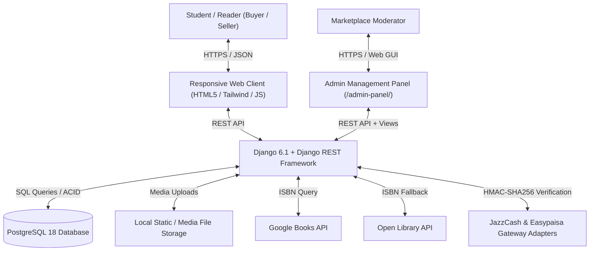
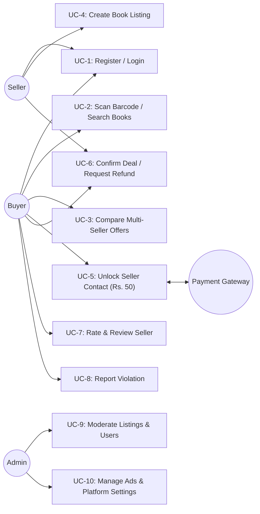
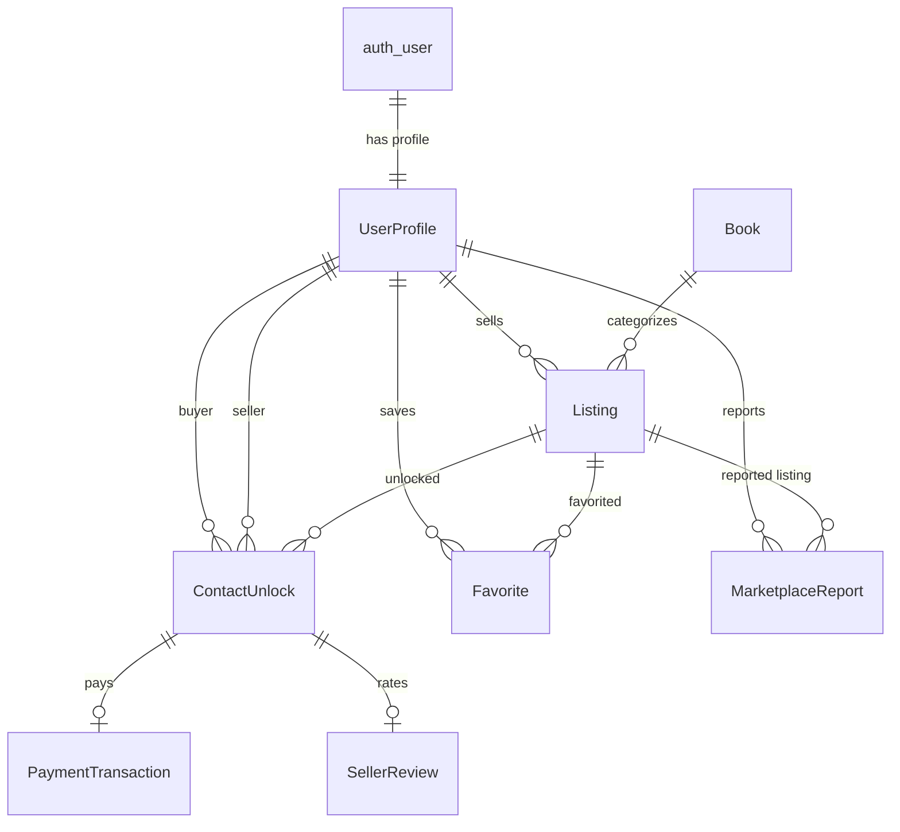
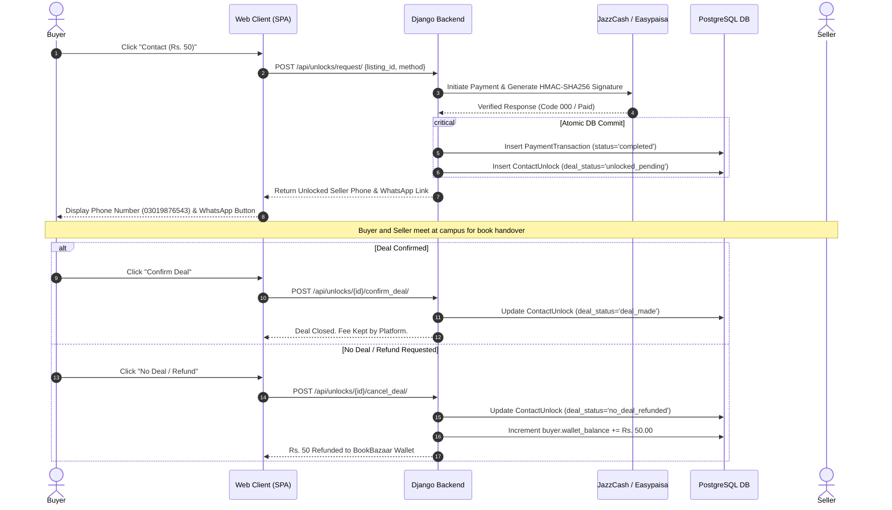
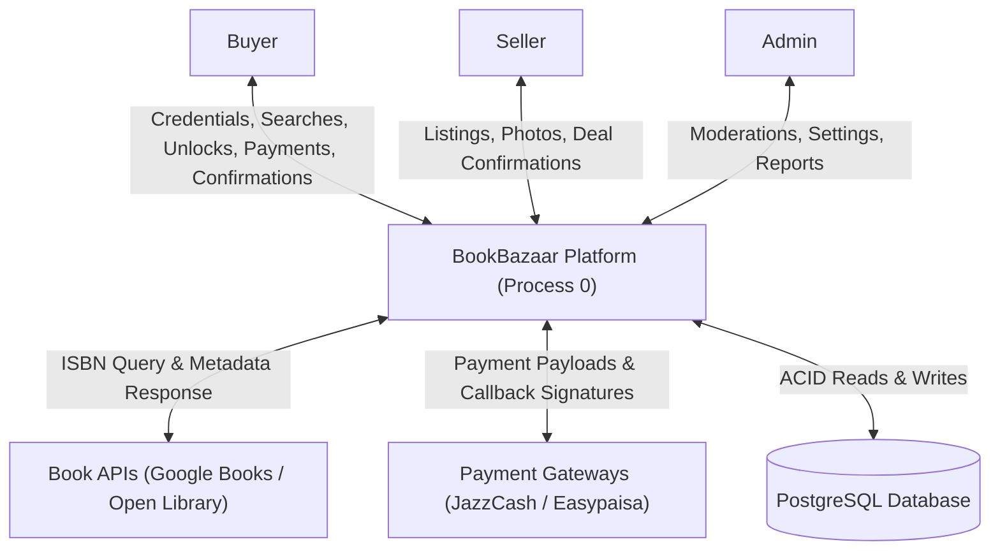
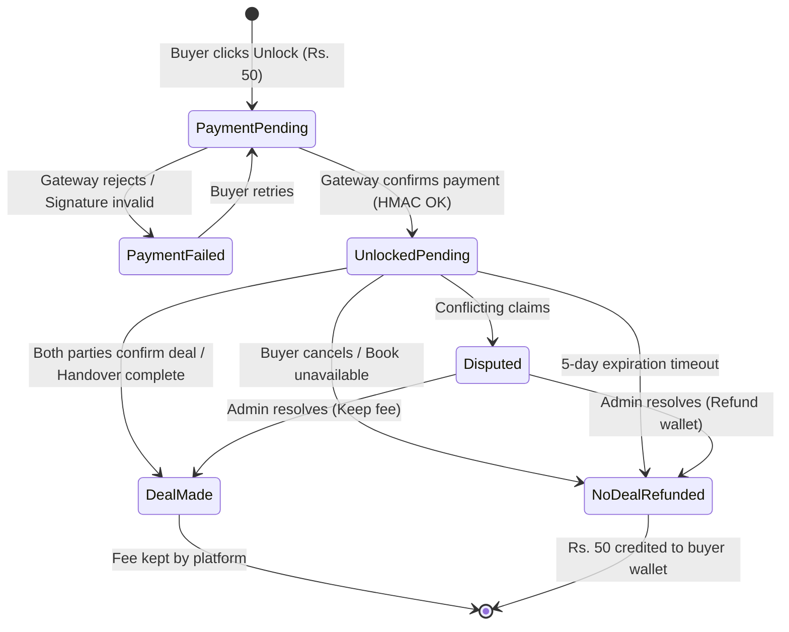

# Software Requirement Specification (SRS)
## for
# BookBazaar
### Used Book Marketplace & Academic Textbook Barcode Platform for Pakistan
**Version 2.0 (Production Implementation Edition)**

---

### Department of Software Engineering
**Faculty of Computing**  
**The Islamia University of Bahawalpur**

**Project Team:**
- **Emaan Mazari** — Roll No: `F23BSEEN1E02157`
- **Laila Akhtar** — Roll No: `F23BSEEN1E02119`

**Project Advisor:**
- **Sir Gulraiz** — Department of Software Engineering, The Islamia University of Bahawalpur

---

## Revision History

| Version | Date | Authors | Reason for Changes |
| :--- | :--- | :--- | :--- |
| **1.0** | 3 Nov 2026 | Emaan Mazari, Laila Akhtar | Initial Draft Specification |
| **2.0** | 9 Nov 2026 | Emaan Mazari, Laila Akhtar | Updated to 100% match implemented Django REST backend, PostgreSQL 18 schema, HTML5/Tailwind responsive client, DRF Token authentication, internal wallet refund lifecycle, and proprietary ad engine |

---

## Document Approval

The following Software Requirements Specification (Version 2.0) has been accepted and approved by:

| Signature | Printed Name | Title | Date |
| :--- | :--- | :--- | :--- |
| | **Sir Gulraiz** | Project Supervisor, Department of Software Engineering | ___________ |

---

## Table of Contents

1. [Introduction](#1-introduction)
   - [1.1 Purpose](#11-purpose)
   - [1.2 Scope](#12-scope)
   - [1.3 Definitions, Acronyms, and Abbreviations](#13-definitions-acronyms-and-abbreviations)
   - [1.4 References](#14-references)
   - [1.5 Overview](#15-overview)
2. [The Overall Description](#2-the-overall-description)
   - [2.1 Product Perspective](#21-product-perspective)
     - [2.1.1 Operations](#211-operations)
     - [2.1.2 Site Adaptation Requirements](#212-site-adaptation-requirements)
   - [2.2 Product Functions](#22-product-functions)
   - [2.3 User Characteristics](#23-user-characteristics)
   - [2.4 General Constraints](#24-general-constraints)
   - [2.5 Assumptions and Dependencies](#25-assumptions-and-dependencies)
3. [Specific Requirements](#3-specific-requirements)
   - [3.1 External Interface Requirements](#31-external-interface-requirements)
     - [3.1.1 System Interfaces](#311-system-interfaces)
     - [3.1.2 User Interfaces](#312-user-interfaces)
     - [3.1.3 Hardware Interfaces](#313-hardware-interfaces)
     - [3.1.4 Software Interfaces](#314-software-interfaces)
     - [3.1.5 Communications Interfaces](#315-communications-interfaces)
   - [3.2 Functional Requirements](#32-functional-requirements)
     - [FR-1: User Registration, Authentication & Profiles](#fr-1-user-registration-authentication--profiles)
     - [FR-2: Barcode Scanning & Multi-Tier Catalog Lookup](#fr-2-barcode-scanning--multi-tier-catalog-lookup)
     - [FR-3: Search, Curriculum Board Filtering & Multi-Seller Comparison](#fr-3-search-curriculum-board-filtering--multi-seller-comparison)
     - [FR-4: Book Listing Creation & Seller Inventory Management](#fr-4-book-listing-creation--seller-inventory-management)
     - [FR-5: Contact Unlock & Privacy Protection (Rs. 50 Fee)](#fr-5-contact-unlock--privacy-protection-rs-50-fee)
     - [FR-6: Secure Local Payment Gateway Integration](#fr-6-secure-local-payment-gateway-integration)
     - [FR-7: Deal Confirmation, In-App Wallet Refund & Dispute Mediation](#fr-7-deal-confirmation-in-app-wallet-refund--dispute-mediation)
     - [FR-8: Seller Ratings and Reviews](#fr-8-seller-ratings-and-reviews)
     - [FR-9: In-App Activity & Transaction Status Updates](#fr-9-in-app-activity--transaction-status-updates)
     - [FR-10: First-Party Proprietary Advertisement Engine](#fr-10-first-party-proprietary-advertisement-engine)
     - [FR-11: Comprehensive Admin Management Dashboard](#fr-11-comprehensive-admin-management-dashboard)
     - [FR-12: Wishlist & User Favorites](#fr-12-wishlist--user-favorites)
     - [FR-13: Marketplace Safety & Listing/User Violation Reports](#fr-13-marketplace-safety--listinguser-violation-reports)
   - [3.3 Use Cases](#33-use-cases)
   - [3.4 Classes and Objects (Data Model Mapping)](#34-classes-and-objects-data-model-mapping)
   - [3.5 Non-Functional Requirements](#35-non-functional-requirements)
   - [3.6 Inverse Requirements](#36-inverse-requirements)
   - [3.7 Logical Database Requirements (PostgreSQL Schema)](#37-logical-database-requirements-postgresql-schema)
   - [3.8 Design Constraints and Standards Compliance](#38-design-constraints-and-standards-compliance)
4. [Analysis Models](#4-analysis-models)
   - [4.1 Sequence Diagrams](#41-sequence-diagrams)
   - [4.2 Data Flow Diagrams (DFD)](#42-data-flow-diagrams-dfd)
   - [4.3 State-Transition Diagrams (STD)](#43-state-transition-diagrams-std)
5. [Supporting Information](#5-supporting-information)
   - [Appendix A – Background Research on Pakistani Used Book Trade](#appendix-a--background-research-on-pakistani-used-book-trade)
   - [Appendix B – Complete Data Dictionary](#appendix-b--complete-data-dictionary)
   - [Appendix C – Phase 6 Mobile App & Production Expansion Roadmap](#appendix-c--phase-6-mobile-app--production-expansion-roadmap)

---

# 1. Introduction

## 1.1 Purpose
This Software Requirements Specification (SRS) establishes the foundational requirements for **BookBazaar**, an automated second-hand textbook marketplace platform developed specifically for students, educators, and general readers across Pakistan, with dedicated campus integration for The Islamia University of Bahawalpur (IUB).

The intended audience includes:
1. **Academic Supervisor & Final Year Project Committee:** To evaluate the functional completeness, architectural integrity, and methodological rigor of the implemented system.
2. **Software Engineers & Developers:** To guide the ongoing maintenance, API consumption, and future mobile client expansion.
3. **Quality Assurance Engineers & Evaluators:** To verify system compliance through automated test suites and end-to-end user journeys.

## 1.2 Scope
**Software Product:** **BookBazaar** is a full-stack web-based platform comprising:
- A responsive, mobile-first Single Page Application (SPA) client featuring a mobile device emulator frame and responsive full-screen desktop interface.
- A RESTful backend engineered with Python, Django, and Django REST Framework (DRF).
- An enterprise-grade PostgreSQL relational database.
- A dedicated administrative management dashboard for marketplace moderation.

**What the Product Does:**
- Allows users to scan ISBN barcodes using their smartphone/web camera or enter 13-digit ISBNs manually.
- Automatically retrieves verified book metadata (title, author, publisher, cover image, and retail price) using a cascading lookup architecture (Local Database -> Curated Pakistani Catalog -> Google Books API -> Open Library API).
- Enables students to list used books for sale in under 60 seconds with condition grades, campus pickup points, selling prices, and uploaded photos.
- Aggregates multiple sellers offering the same textbook and sorts them by lowest price.
- Masks seller contact details to protect user privacy.
- Unlocks the seller's verified mobile phone number and direct WhatsApp link upon payment of a nominal platform fee (default: Rs. 50 PKR).
- Enforces a 100% refundable guarantee: if buyer and seller finalize the physical book exchange, the platform retains the fee; if no deal is made or the book is unavailable, the Rs. 50 fee is credited immediately back to the buyer's internal BookBazaar wallet balance.
- Serves internal banner, interstitial, and sponsored advertisement campaigns managed by the admin.
- Provides comprehensive moderation, seller monitoring, transaction auditing, and violation reporting.

**What the Product Does Not Do:**
- BookBazaar does not purchase, warehouse, or deliver physical books. Handover and physical book payment take place peer-to-peer between students at agreed campus locations.
- BookBazaar does not collect commissions on physical book sales; its platform revenue is derived exclusively from contact-unlock fees and sponsored listings.
- BookBazaar does not support foreign currencies; all financial tracking is strictly in Pakistani Rupees (PKR).

## 1.3 Definitions, Acronyms, and Abbreviations

| Term / Abbreviation | Definition |
| :--- | :--- |
| **SRS** | Software Requirements Specification |
| **SDD** | Software Design Document |
| **FYP** | Final Year Project (Department of Software Engineering, IUB) |
| **ISBN** | International Standard Book Number (ISO 2108), standard 10 or 13-digit identifier |
| **DRF** | Django REST Framework |
| **Token Auth** | Token-based HTTP authentication scheme (`Authorization: Token <key>`) provided by DRF |
| **PKR / Rs.** | Pakistani Rupee |
| **Contact Unlock Fee**| Platform access fee (default: Rs. 50) charged to reveal seller contact details |
| **Wallet Balance** | Internal digital store of value within BookBazaar used for instant refund crediting and re-unlocks |
| **HMAC-SHA256** | Hash-based Message Authentication Code with SHA-256 hash function, used for digital signatures in JazzCash & Easypaisa |
| **SPA** | Single Page Application, dynamic web application without full-page reloads |
| **IUB** | The Islamia University of Bahawalpur |

## 1.4 References
1. IEEE Std 830-1998, *IEEE Recommended Practice for Software Requirements Specifications*.
2. ISO/IEC/IEEE 29148:2018, *Systems and software engineering — Life cycle processes — Requirements engineering*.
3. ISO 2108:2017, *Information and documentation — International standard book number (ISBN)*.
4. Django Documentation (v6.1), *https://docs.djangoproject.com/*.
5. Django REST Framework Documentation, *https://www.django-rest-framework.org/*.
6. JazzCash Merchant Integration Guide & API Specifications (MWALLET / HTTP Post Interface).
7. Easypaisa Payment Gateway Merchant Integration Standards.
8. BookBazaar Project Proposal, Dept. of Software Engineering, The Islamia University of Bahawalpur.

## 1.5 Overview
The remainder of this document defines the product perspective, architectural context, functional modules (FR-1 through FR-13), non-functional constraints, complete PostgreSQL relational models, analysis diagrams (Sequence, DFD, State), and supporting data dictionaries.

---

# 2. The Overall Description

## 2.1 Product Perspective
BookBazaar is an autonomous web-based platform tailored to Pakistani higher education and secondary school environments. In traditional Pakistani universities, students rely on unstructured WhatsApp groups, Facebook pages, or physical second-hand book stalls in city bazaars. These manual channels suffer from unverified pricing, fraud, spam contacts, and no aggregated price discovery.

BookBazaar solves this problem through an automated digital marketplace:

### 2.1.1 Operations
- **Interactive Marketplace Operation:** Available 24/7. Users browse, search, scan barcodes, list books, and unlock contacts.
- **Administrative Moderation:** Administrators log in through `/admin-panel/` to review listings, resolve disputes, monitor payments, adjust platform fees, and block fraudulent users.
- **Automated Lifecycle Processing:** Unconfirmed deals auto-refund after the configured expiration threshold (default: 5 days) without human intervention.
- **Backup & Recovery:** Daily automated PostgreSQL database dumps with a 7-day rolling retention policy.

### 2.1.2 Site Adaptation Requirements
- Web servers running Python 3.12+ with PostgreSQL 16+ on local development or Linux production environments (Ubuntu 24.04 LTS).
- Modern web browser (Chrome, Edge, Firefox, Safari) with WebRTC camera permissions enabled for live barcode scanning.
- Active network access to Google Books and Open Library external REST APIs.

## 2.2 Product Functions
1. **User Authentication & Profiles:** Registration with Pakistani mobile number validation, PBKDF2 password hashing, DRF Token authentication, and demo OTP switching.
2. **Barcode Scanner & Multi-Tier Lookup:** Camera-based barcode reading using HTML5 `getUserMedia` and instant metadata resolution.
3. **Curriculum & Board Filtering:** Specialized filtering for Pakistani educational boards (Punjab, Federal, Sindh, Cambridge, University/HEC) and class levels.
4. **Listings & Inventory:** Listing creation with selling price, condition grading, campus meeting points, and photo upload.
5. **Contact Unlock & Masking:** Privacy-first masking of phone numbers (`0301-*******`) until verified payment.
6. **Local Payment Gateways:** JazzCash and Easypaisa integration with cryptographic HMAC-SHA256 signature verification.
7. **Deal Lifecycle & Wallet Refund:** 100% refundable contact fee credited to the internal wallet if no deal is made.
8. **Reputation & Reviews:** Verified post-deal ratings (1 to 5 stars) and buyer reviews.
9. **Proprietary Ad Engine:** Admin-configurable top banners, bottom banners, interstitials, and native cards.
10. **Moderation & Reporting:** Complete complaint filing and admin dispute resolution system.

## 2.3 User Characteristics
- **Students (Primary Users):** University and college students aged 16 to 28 who buy and sell textbooks per semester. They prioritize lowest cost, campus pickup convenience, and WhatsApp communication.
- **General Readers:** Book enthusiasts buying novels, history, and competitive exam books (CSS/PMS).
- **Bookstore Owners:** Small bookshop retailers listing second-hand inventory.
- **Administrators:** Faculty or system administrators moderating content and monitoring transactions.

## 2.4 General Constraints
- **Currency & Banking:** All transactions are denominated strictly in Pakistani Rupees (PKR).
- **Privacy Regulation:** Direct personal phone numbers must never be exposed publicly without an authenticated, paid unlock record.
- **Auditability:** Financial logs, refund IDs, and admin actions must be permanently retained for audit purposes.

## 2.5 Assumptions and Dependencies
- The buyer pays the Rs. 50 platform unlock fee; the seller does not pay any fee to list books.
- Handover of the physical book and payment of the book's selling price occur directly between the buyer and seller.
- The external Google Books and Open Library APIs are reachable via outgoing HTTPS.

---

# 3. Specific Requirements

## 3.1 External Interface Requirements

### 3.1.1 System Interfaces
- **Google Books REST API:** `https://www.googleapis.com/books/v1/volumes?q=isbn:{isbn}` (Returns JSON metadata).
- **Open Library Books API:** `https://openlibrary.org/api/books?bibkeys=ISBN:{isbn}&format=json&jscmd=data`.
- **JazzCash Sandbox Gateway:** Merchant REST/HTTP Post interface using HMAC-SHA256 signature algorithm.
- **Easypaisa Sandbox Gateway:** Direct wallet transaction authorization API.

### 3.1.2 User Interfaces
- **Mobile Emulator & Responsive Layout:** The web client renders within an interactive smartphone mockup frame (simulating native mobile user experience) with a quick toggle for standard full-screen desktop mode.
- **Bilingual Interface:** Full toggle between English and Urdu (`اردو`) with dynamic localized text strings.
- **Toast Notifications & Modals:** Asynchronous visual feedback for logins, listing creations, and payments.

### 3.1.3 Hardware Interfaces
- **Camera Device:** WebRTC-compliant rear/front camera interface via `navigator.mediaDevices.getUserMedia` for barcode video stream decoding.
- **Flash / Torch:** Web camera torch control in low-light environments.

### 3.1.4 Software Interfaces
- **Operating System:** Windows, macOS, or Linux (cross-platform web client; Python/Django server).
- **Database Engine:** PostgreSQL 16+ via `psycopg2-binary`.
- **Image Processing Library:** Pillow (Python Imaging Library) for server-side image verification and thumbnailing.

### 3.1.5 Communications Interfaces
- All client-server communication uses HTTPS (TLS 1.2 or higher) carrying JSON payloads.
- REST API uses standard HTTP verbs (`GET`, `POST`, `PUT`, `DELETE`).

---

## 3.2 Functional Requirements

### FR-1: User Registration, Authentication & Profiles
- **FR-1.1:** The system shall register users with a valid 11-digit Pakistani mobile number (`03XX-XXXXXXX`), full name, city, and secure password.
- **FR-1.2:** Passwords shall be securely hashed using Django's default PBKDF2-SHA256 algorithm with salted key stretching.
- **FR-1.3:** Upon valid credential verification, the system shall issue a 40-character hexadecimal REST Framework Authentication Token.
- **FR-1.4:** The user shall be able to update their full name, city, and campus area.
- **FR-1.5:** A single user account can act simultaneously as a buyer and a seller without switching credentials.
- **FR-1.6:** For academic and viva demonstration, the system shall provide an OTP quick-login and demo user switcher to simulate multi-user workflows instantly.

### FR-2: Barcode Scanning & Multi-Tier Catalog Lookup
- **FR-2.1:** The system shall accept 10-digit and 13-digit ISBN barcode inputs via live video scanner or manual text box.
- **FR-2.2:** The backend shall query catalog metadata in the following strict cascading order:
  1. *Local Database:* Existing records in the `Book` table.
  2. *Curated Pakistani Catalog (`KNOWN_CATALOG`):* Pre-cached authoritative university syllabus textbooks.
  3. *Google Books API:* Real-time REST query.
  4. *Open Library API:* Secondary public API.
  5. *Manual Entry:* Allows seller to manually input title and author if not found.
- **FR-2.3:** Retrieved book records shall be automatically cached in the local database to accelerate future lookups.

### FR-3: Search, Curriculum Board Filtering & Multi-Seller Comparison
- **FR-3.1:** The search engine shall perform case-insensitive substring queries across book titles, authors, subjects, and ISBNs.
- **FR-3.2:** The system shall support multi-parameter filtering by:
  - *Educational Board:* Punjab Board, Federal Board, Sindh Board, Cambridge, Higher Education / University (HEC, IUB).
  - *Class / Grade Level:* Matric, Intermediate/FSc, Bachelor/BS, Master, CSS/PMS Entry Test.
  - *Condition:* Brand New, Like New, Good, Fair.
  - *City:* Bahawalpur, Lahore, Karachi, Islamabad, Multan, Faisalabad, etc.
  - *Price Sorting:* Lowest price first, newest listings, or highest savings percentage.
- **FR-3.3:** When viewing a book, the system shall aggregate all active listings from different sellers and display them in a price-comparison table sorted by lowest price.

### FR-4: Book Listing Creation & Seller Inventory Management
- **FR-4.1:** An authenticated seller shall be able to list a book by providing book condition, seller-decided selling price (PKR), city, campus pickup point, description, and photo.
- **FR-4.2:** The seller shall have sole authority over the selling price; the platform shall never alter or dictate book prices.
- **FR-4.3:** Uploaded listing photos shall be validated for allowed file formats (JPEG, PNG, WebP) and size limits (<= 5MB).
- **FR-4.4:** Sellers shall be able to edit the price, description, condition, pickup location, or mark the listing as sold/inactive.

### FR-5: Contact Unlock & Privacy Protection (Rs. 50 Fee)
- **FR-5.1:** Direct seller contact details (phone number and WhatsApp link) shall remain strictly masked (`0301-*******`) across all public APIs and UI views.
- **FR-5.2:** To reveal contact details, the buyer must initiate an unlock request for a specific listing and pay the platform unlock fee (default: Rs. 50.00 PKR).
- **FR-5.3:** The platform shall prevent self-unlocks (a user cannot unlock their own listing).
- **FR-5.4:** The platform shall prevent duplicate unlocks (a buyer cannot be charged twice for an already unlocked listing).

### FR-6: Secure Local Payment Gateway Integration
- **FR-6.1:** The system shall support payment via **JazzCash**, **Easypaisa**, Debit/Credit Card adapter, and In-App Wallet balance.
- **FR-6.2:** For gateway transactions, the backend shall construct the secure payload and calculate the digital signature using sorted parameter keys and the secret Integrity Salt via HMAC-SHA256 (`pp_SecureHash`).
- **FR-6.3:** Incoming gateway callbacks shall be cryptographically validated before status transition. Tampered signatures shall be rejected immediately with HTTP 400.
- **FR-6.4:** Payment and unlock creation shall execute inside an atomic database transaction (`transaction.atomic`) to ensure zero financial inconsistency.

### FR-7: Deal Confirmation, In-App Wallet Refund & Dispute Mediation
- **FR-7.1:** Following payment, the transaction status becomes `completed`, while the physical deal lifecycle status becomes `unlocked_pending`.
- **FR-7.2:** If the buyer and seller successfully meet and finalize the exchange, either party can click **"Confirm Deal"**, transitioning `deal_status` to `'deal_made'`. The platform permanently retains the Rs. 50 fee.
- **FR-7.3:** If the seller is unreachable, the book was already sold, or the physical condition is rejected, the buyer clicks **"No Deal / Cancel"**.
- **FR-7.4:** Upon deal cancellation, the system immediately credits 100% of the unlock fee (Rs. 50.00) back into the buyer's internal BookBazaar wallet balance (`buyer.wallet_balance += fee_amount`), records a unique refund transaction ID (`REF-XXXXXX`), and marks `deal_status = 'no_deal_refunded'`.
- **FR-7.5:** The system shall strictly prevent duplicate refunds; secondary refund attempts shall be rejected without altering wallet balances.
- **FR-7.6:** If an unconfirmed deal remains inactive past the expiration threshold (default: 5 days), it shall auto-refund to the buyer's wallet.

### FR-8: Seller Ratings and Reviews
- **FR-8.1:** A buyer with a resolved unlock record (`deal_made` or `no_deal_refunded`) shall be permitted to submit a 1 to 5-star rating and written review for the seller.
- **FR-8.2:** Each unlock shall allow at most one submitted review (enforced via database unique constraint).
- **FR-8.3:** Upon review submission, the seller's cumulative average rating and total review count shall recalculate automatically.

### FR-9: In-App Activity & Transaction Status Updates
- **FR-9.1:** The user profile interface shall display real-time counters of active listings, sold listings, contacts bought, and contacts received.
- **FR-9.2:** The "My Deals" tab shall list all active, confirmed, and refunded transactions with direct action buttons (Call Seller, WhatsApp Chat, Confirm Deal, No Deal Refund, and Rate Seller).

### FR-10: First-Party Proprietary Advertisement Engine
- **FR-10.1:** The system shall support four native ad formats:
  - Top Banner Ad (`banner_top`)
  - Bottom Sticky Banner Ad (`banner_bottom`)
  - Interstitial Modal Ad (`interstitial`) displayed upon publishing a listing
  - Native Sponsored Feed Card (`native_feed`)
- **FR-10.2:** The ad service shall track impressions and click-through counts for every active campaign.
- **FR-10.3:** Advertisements shall never be rendered on checkout, payment, or OTP verification modals.

### FR-11: Comprehensive Admin Management Dashboard
- **FR-11.1:** The admin panel (`/admin-panel/`) shall be restricted to staff/superuser accounts.
- **FR-11.2:** The dashboard shall present real-time marketplace metrics: total registered users, active listings, gross contact fees collected, total refunded amounts, net platform revenue, and dispute counts.
- **FR-11.3:** Administrators shall be able to view all users, inspect profiles, and block or unblock accounts (`is_blocked`).
- **FR-11.4:** Administrators shall be able to moderate listings (approve, reject, edit, or delete listings).
- **FR-11.5:** Administrators shall be able to adjust global system settings (`contact_unlock_fee`, `auto_refund_days`, `require_admin_approval`) without restarting the server.
- **FR-11.6:** Administrators shall be able to create, edit, toggle, and delete advertisement campaigns.

### FR-12: Wishlist & User Favorites
- **FR-12.1:** Authenticated users shall be able to toggle any listing into their personal favorites list with one click.
- **FR-12.2:** The system shall provide a dedicated "Favourites" view filtering the marketplace to only saved listings.

### FR-13: Marketplace Safety & Listing/User Violation Reports
- **FR-13.1:** Users shall be able to report fraudulent listings or abusive sellers using a structured reporting modal.
- **FR-13.2:** Violation categories shall include: *Fraud / Fake Listing*, *Misleading Price*, *Condition Not As Described*, *Unresponsive Seller*, *Abusive Behavior*, and *Copyright / Piracy*.
- **FR-13.3:** Administrators shall review pending reports in the admin panel and take moderation action (dismiss, investigate, or resolve with user blocking).

---

## 3.3 Use Cases

### Detailed Use Case Specifications:

#### UC-1: Register / Login
- **Primary Actor:** Buyer / Seller.
- **Precondition:** Web client loaded in browser.
- **Main Flow:**
  1. User enters 11-digit phone number, full name, city, and password.
  2. Backend validates format, hashes password via PBKDF2, and saves `UserProfile`.
  3. Server issues authentication Token and logs user into active session.
- **Alternative Flow:** User enters existing phone number and password -> authenticated immediately.

#### UC-2: Scan Book Barcode
- **Primary Actor:** Buyer / Seller.
- **Main Flow:**
  1. User taps "Scan Barcode" or enters ISBN.
  2. Camera captures EAN-13 barcode video stream.
  3. Backend queries local DB, then curated catalog, then Google Books.
  4. Returns complete book metadata and all active seller listings sorted by price.

#### UC-4: Create Book Listing
- **Primary Actor:** Seller.
- **Precondition:** User is authenticated.
- **Main Flow:**
  1. Seller scans ISBN or enters title/author.
  2. Seller selects condition (*Brand New*, *Like New*, *Good*, *Fair*).
  3. Seller specifies selling price (PKR) and campus pickup location.
  4. Seller uploads photo and submits.
  5. Listing is saved as `active` (or `pending` if admin review is required).

#### UC-5: Unlock Seller Contact
- **Primary Actor:** Buyer, Payment Gateway.
- **Precondition:** Buyer viewing an active listing belonging to another user.
- **Main Flow:**
  1. Buyer clicks "Contact (Rs. 50)".
  2. Modal displays Rs. 50 fee, 100% refund guarantee, and sandbox gateway indicator.
  3. Buyer chooses JazzCash, Easypaisa, or In-App Wallet and submits account number.
  4. Backend verifies HMAC-SHA256 signature, creates `PaymentTransaction` (`completed`), and creates `ContactUnlock` (`unlocked_pending`).
  5. UI updates immediately revealing seller's direct phone number and WhatsApp chat button.

#### UC-6: Confirm Deal & Wallet Refund
- **Primary Actor:** Buyer, Seller.
- **Precondition:** Contact details unlocked.
- **Main Flow (Deal Made):**
  1. Buyer and seller meet at campus and complete book exchange.
  2. User taps "Confirm Deal".
  3. `deal_status` transitions to `deal_made`. Platform keeps Rs. 50 fee.
- **Alternative Flow (No Deal / Refund):**
  1. Seller is unreachable or book is rejected.
  2. Buyer taps "No Deal / Refund".
  3. Server transitions `deal_status` to `no_deal_refunded`.
  4. Server credits Rs. 50.00 directly to buyer's wallet balance (`buyer.wallet_balance += 50.00`).
  5. Unique refund reference (`REF-XXXXXX`) is generated.

---

## 3.4 Classes and Objects (Data Model Mapping)

The system classes directly map to Django models in `bazaar/models.py`:

1. **`UserProfile`:** Extends Django's `auth_user` with `phone_number`, `city`, `campus_or_area`, `user_type`, `rating`, `total_reviews`, `wallet_balance`, and `is_blocked`.
2. **`Book`:** Catalog model containing `isbn`, `title`, `author`, `publisher`, `edition`, `category`, `education_board`, `grade_class`, `subject`, `cover_image`, and `original_retail_price`.
3. **`Listing`:** Offer model containing `book`, `seller`, `condition`, `price`, `city`, `pickup_location`, `image`, `status`, and `is_sponsored`.
4. **`ContactUnlock`:** Unified unlock and deal state machine containing `unlock_id`, `listing`, `buyer`, `seller`, `fee_amount`, `payment_method`, `deal_status`, `buyer_confirmation`, `seller_confirmation`, and `refund_transaction_id`.
5. **`PaymentTransaction`:** Financial transaction log containing `transaction_id`, `gateway_ref`, `buyer`, `listing`, `amount`, `currency`, `gateway`, `status`, and `verified_at`.
6. **`SellerReview`:** 1-to-1 rating model linked to `ContactUnlock` containing `seller`, `buyer`, `rating` (1 to 5), and `comment`.
7. **`Advertisement`:** In-house marketing model containing `title`, `sponsor_name`, `ad_type`, `image_url`, `headline`, `impressions`, `clicks`, and `is_active`.
8. **`PlatformSetting`:** Global dynamic config model containing `contact_unlock_fee`, `auto_refund_days`, and `require_admin_approval`.
9. **`MarketplaceReport`:** Safety report model containing `report_id`, `reporter`, `listing`, `reported_user`, `report_type`, `description`, and `status`.
10. **`Favorite`:** Wishlist model containing `user` and `listing`.

---

## 3.5 Non-Functional Requirements

### 3.5.1 Performance
- **NFR-P1:** Barcode metadata lookup shall complete within **1.5 seconds** for cached catalog items and within **3 seconds** for external API calls.
- **NFR-P2:** Marketplace search and filtering queries across the PostgreSQL database shall return within **500 milliseconds**.
- **NFR-P3:** Static assets (CSS, JavaScript, mockups) shall be cached and served efficiently with HTTP 200/304 status codes via WhiteNoise.

### 3.5.2 Reliability & Financial Integrity
- **NFR-R1:** Zero financial leakage: Every unlock fee must have a corresponding verified `PaymentTransaction` record.
- **NFR-R2:** Atomic transactions (`transaction.atomic`) and row-level database locking (`select_for_update`) shall prevent duplicate unlocks and double-refunds during concurrent requests.

### 3.5.3 Security
- **NFR-S1:** Password storage shall use salted PBKDF2-SHA256 hashing. Cleartext passwords shall never be saved or logged.
- **NFR-S2:** Sensitive personal phone numbers shall never be exposed through public catalog APIs.
- **NFR-S3:** All administrative endpoints (`/api/admin/...`) shall enforce `IsAdminUser` permissions.
- **NFR-S4:** Payment callback endpoints shall verify HMAC-SHA256 signatures before authorizing unlocks.

### 3.5.4 Maintainability & Extensibility
- **NFR-M1:** Clean separation of concerns: Business logic isolated in `bazaar/services/` (`book_service.py`, `payment_service.py`), views in `bazaar/views.py`, and data access in `bazaar/models.py`.
- **NFR-M2:** Platform settings (fees, refund days) shall be configurable via the admin dashboard without modifying source code.

### 3.5.5 Portability & Responsiveness
- **NFR-PO1:** The web client shall render responsively on mobile viewports (360px width) through 4K desktop screens.
- **NFR-PO2:** The application shall run identically across standard modern browsers (Chrome, Edge, Firefox, Safari).

---

## 3.6 Inverse Requirements
- The system shall **not** act as a book merchant or hold physical book stock.
- The system shall **not** set or cap book selling prices; pricing is strictly determined by the seller.
- The system shall **not** charge commissions or fees on the physical book price.
- The system shall **not** reveal a seller's phone number or WhatsApp link prior to verified payment.
- The system shall **not** credit more than one refund for a single unlock transaction.

---

## 3.7 Logical Database Requirements (PostgreSQL Schema)

---

# 4. Analysis Models

## 4.1 Sequence Diagram: Unlock, Payment, Deal & Refund

## 4.2 Data Flow Diagram (Level-0 DFD)

## 4.3 State-Transition Diagram: Contact Unlock Lifecycle

---

# 5. Supporting Information

## Appendix A – Background Research on Pakistani Used Book Trade
1. **Academic Textbook Economy:** Pakistani university and college curricula rely heavily on standard international editions (e.g. *Silberschatz's Operating Systems*, *Pressman's Software Engineering*) or national boards (Punjab, Sindh, Federal, Cambridge). New editions retail between Rs. 1,500 and Rs. 3,500, posing a significant financial barrier. Second-hand trades reduce semester textbook expenses by **60% to 80%**.
2. **Payment Ecosystem in Pakistan:** Credit and debit card penetration among university students is low (< 15%). The vast majority utilize mobile branchless banking wallets: **JazzCash** (Mobilink Microfinance Bank) and **Easypaisa** (Telenor Microfinance Bank). Supporting mobile account numbers and in-app wallet balances is essential for market adoption.
3. **Campus Meeting Dynamics:** Because university students attend the same campus, physical delivery via couriers (TCS, Leopards, Pakistan Post) introduces unnecessary shipping fees (Rs. 250–400) that often exceed the book's value. Peer-to-peer campus pickup points (e.g. IUB Library, Department Gates) represent the fastest, zero-cost delivery channel.

## Appendix B – Complete Data Dictionary

| Model / Table | Attribute | Data Type | Constraints / Details |
| :--- | :--- | :--- | :--- |
| **`UserProfile`** | `user` | OneToOne | Foreign key to Django `auth_user` |
| | `phone_number` | VARCHAR(20) | Unique, Pakistani format (`03XX-XXXXXXX`) |
| | `city` | VARCHAR(80) | Choices (Bahawalpur, Lahore, Karachi, etc.) |
| | `campus_or_area` | VARCHAR(150) | Campus name / pickup neighborhood |
| | `wallet_balance` | DECIMAL(10,2) | In-app credit balance in PKR |
| | `rating` | DECIMAL(3,2) | Average seller star rating (1.00 to 5.00) |
| | `is_blocked` | BOOLEAN | Moderator suspension flag |
| **`Book`** | `isbn` | VARCHAR(20) | Unique ISBN-10 or ISBN-13 identifier |
| | `title` | VARCHAR(255) | Book title |
| | `author` | VARCHAR(255) | Book author(s) |
| | `category` | VARCHAR(100) | Academic discipline category |
| | `education_board` | VARCHAR(100) | Educational board (Punjab, Cambridge, HEC, etc.) |
| | `grade_class` | VARCHAR(100) | Class level (Matric, FSc, Bachelor, Master, etc.) |
| | `cover_image` | TEXT | URL or base64 image data |
| | `original_retail_price`| DECIMAL(10,2)| Estimated new book retail price in PKR |
| **`Listing`** | `book` | ForeignKey | References `Book` |
| | `seller` | ForeignKey | References `UserProfile` |
| | `condition` | VARCHAR(20) | Brand New, Like New, Good, Fair |
| | `price` | DECIMAL(10,2) | Seller selling price in PKR |
| | `pickup_location` | VARCHAR(150) | Meeting location at university |
| | `image` | ImageField | Uploaded book photo file (Pillow validated) |
| | `status` | VARCHAR(20) | `active`, `pending`, `sold`, `inactive` |
| | `is_sponsored` | BOOLEAN | Promoted listing shown at top |
| **`ContactUnlock`**| `unlock_id` | UUID | Unique public token identifier |
| | `listing` | ForeignKey | References `Listing` |
| | `buyer` | ForeignKey | References `UserProfile` |
| | `seller` | ForeignKey | References `UserProfile` |
| | `fee_amount` | DECIMAL(6,2) | Unlock fee (Rs. 50.00 default) |
| | `payment_method` | VARCHAR(30) | JazzCash, Easypaisa, Card, Wallet |
| | `deal_status` | VARCHAR(30) | `unlocked_pending`, `deal_made`, `no_deal_refunded`, `disputed` |
| | `refund_transaction_id`| VARCHAR(100)| Refund reference (`REF-XXXXXX`) |
| **`PaymentTransaction`**| `transaction_id`| UUID | Unique transaction identifier |
| | `amount` | DECIMAL(10,2)| Amount paid in PKR |
| | `gateway` | VARCHAR(30) | `jazzcash`, `easypaisa`, `card_safepay`, `wallet` |
| | `status` | VARCHAR(20) | `pending`, `completed`, `failed`, `refunded` |
| **`SellerReview`** | `unlock` | OneToOne | References `ContactUnlock` |
| | `rating` | INTEGER | 1, 2, 3, 4, 5 stars |
| | `comment` | TEXT | Review comment |
| **`Advertisement`** | `ad_type` | VARCHAR(30) | `banner_top`, `banner_bottom`, `interstitial`, `native_feed` |
| | `impressions` | INTEGER | Number of times displayed |
| | `clicks` | INTEGER | Number of times clicked |
| **`PlatformSetting`** | `contact_unlock_fee` | DECIMAL(6,2)| Configurable unlock fee in PKR |
| | `auto_refund_days` | INTEGER | Timeout days (default: 5) |
| **`MarketplaceReport`**| `report_type` | VARCHAR(40) | Fraud, Wrong Price, Condition, Abusive, etc. |
| | `status` | VARCHAR(20) | `pending`, `investigating`, `resolved`, `dismissed` |

## Appendix C – Phase 6 Mobile App & Production Expansion Roadmap
1. **Cross-Platform Flutter Mobile Apps (Android & iOS):** Development of dedicated client applications consuming the existing Django REST API.
2. **Direct Telecom SMS Gateway:** Transition from developer verification protocol to commercial telecom aggregators (e.g. Telenor / Jazz SMS API) for one-time password distribution.
3. **Commercial Production Gateways:** Execution of corporate merchant agreements with Mobilink Microfinance Bank and Telenor Microfinance Bank to move from sandbox to live IPN gateway endpoints.
4. **Automated Asynchronous Celery / Redis Queues:** Background workers for scheduled auto-refund scans and transactional notifications.
